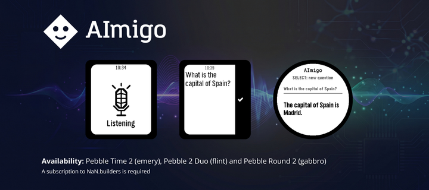

# AImigo

Your (small) AI voice assistant, right on your wrist.

⚠️ Requires a [NaN.builders](https://nan.builders) API key and the Pebble phone
app connected for dictation.

Supported watches:

- ✅ Pebble Time 2 (`emery`)
- ✅ Pebble 2 Duo (`flint`)
- ✅ Pebble Round 2 (`gabbro`)

Press a button, dictate your question and this voice assistant replies right
on your Pebble. On watches with a speaker, the answer is read aloud too.

- Voice dictation through the watch microphone
- AI-powered answers — pick your model in the settings (Gemma 4 or Qwen 3.6)
- Spoken answers on speaker-equipped watches; hold UP to replay
- Talk to it in 🇪🇸 Spanish, 🇬🇧 English, 🇫🇷 French, 🇮🇹 Italian or 🇵🇹
  Portuguese — it replies in the same language
- Simple interface: ask, read or listen, ask again

Built for quick questions and short answers (about a sentence), tailored to
what a watch can comfortably handle.

On speakerless watches you get text answers with a vibration.

Available on the [Pebble](https://apps.repebble.com/6ac8f6b8836dec0008982ccb)
and [Rebble](https://apps.rebble.io/en_US/application/6ac8f6b8836dec0008982ccb) app stores.



## Supported watches

| Compatibility    | Internal name (platform) | External name                        | Company        | Mic          | Speaker |
| ---------------- | ------------------------ | ------------------------------------ | -------------- | ------------ | ------- | --- |
| ✅ Supported     | `emery`                  | Pebble Time 2 (formerly Core Time 2) | Core Devices   | Yes          | Yes     |
| ✅ Supported     | `flint`                  | Pebble 2 Duo (formerly Core 2 Duo)   | Core Devices   | Yes          | Yes     |
| ✅ Supported     | `gabbro`                 | Pe                                   | Pebble Round 2 | Core Devices | Yes     | No  |
| ❌ Not supported | `aplite`                 | Pebble, Pebble Steel                 | Pebble         | No           | No      |
| ❌ Not supported | `basalt`                 | Pebble Time, Pebble Time Steel       | Pebble         | Yes          | No      |
| ❌ Not supported | `chalk`                  | Pebble Time Round                    | Pebble         | Yes          | No      |
| ❌ Not supported | `diorite`                | Pebble 2, Pebble 2 SE                | Pebble         | Yes          |

The app is only built for the Core Devices models. Original Pebble watches
are left out deliberately: the original Pebble has no microphone (no
dictation), and the rest have no speaker (the app would be text-only there).

## Features

- Voice dictation via the watch microphone (system STT through the phone app).
- LLM-powered answers (NaN models: Gemma 4 or Qwen 3.6, selectable in
  settings; short responses, no internet access).
- Text-to-speech playback on speaker-equipped watches (NaN `kokoro` voices).
- Replay the last answer by holding **UP**.
- Bilingual settings page (Clay) with API key, model, language and voice
  pickers.
- 5 languages: 🇪🇸 Español, 🇬🇧 English, 🇫🇷 Français, 🇮🇹 Italiano, 🇵🇹 Português.
- Text-only mode with vibration feedback on Gabbro (no speaker).

## Requirements

- [Pebble Tool](https://developer.repebble.com/sdk/) with SDK 4.9+ (tested with 4.33.1)
- A [NaN](https://nan.builders) account with a personal API key (generated at
  [cloud.nan.builders](https://cloud.nan.builders/))
- The Pebble app (Core Devices) on your phone: it provides the speech-to-text
  (dictation) engine and acts as the network gateway (PebbleKit JS)

## Building & running

```sh
pebble build                            # builds for emery, flint and gabbro
pebble install --emulator emery         # install in the emulator
pebble emu-app-config --emulator emery  # open app settings
pebble install --phone <ip>             # install on a paired watch
```

## Usage

1. Install the app (it shows up as **AImigo**) and open its settings page
   (gear icon in the Pebble phone app):
   - **NaN API key** (password-type field, with a _Show_ button)
   - **Model**: Gemma 4 (recommended) or Qwen 3.6, used to generate the
     answers; these models have no internet access, they only know their
     training data.
   - **Language**: 🇪🇸 Español, 🇬🇧 English, 🇫🇷 Français, 🇮🇹 Italiano, 🇵🇹 Português (defines
     the watch UI language, the AI's response language and the default voice)
   - **Voice**: NaN kokoro voices labeled by language (ES/EN/FR/IT/PT),
     each with a **▶** button to hear a sample ("Hi, how can I help you?"
     in that voice's language; it uses the API key entered on the page)
2. Open AImigo on the watch: if the phone is connected, dictation starts
   automatically; press **SELECT** to dictate (or retry).
3. The answer (max ~12 words) appears in large text; black header, question
   and answer scroll together with **DOWN**/**UP** if they don't fit on
   screen (with a separator line between question and answer). On
   Emery/Flint the answer is played through the speaker once the audio has
   finished downloading (the status line shows the progress).
4. **Hold UP** (~0.6 s) to hear the audio again. **SELECT** asks a new
   question. **BACK** exits.

On Gabbro (no speaker) the answer is text-only, with a vibration as
notification.

### Languages

You can talk to AImigo in 5 languages: **🇪🇸 Español, 🇬🇧 English,
🇫🇷 Français, 🇮🇹 Italiano, 🇵🇹 Português**. Pick one in the settings
page; it affects:

- **Your questions**: dictated with the watch mic and transcribed by the
  phone's STT. The SDK does not allow pinning the STT language (the phone
  app sets it), so these 5 are the common ground between NaN's kokoro voices
  and the phone's STT; actual availability depends on the phone app and
  firmware.
- **The answers**: the AI replies in the chosen language, read aloud with
  the default TTS voice for that language (unless you pick another voice).
- **The watch UI**: in Spanish if the chosen language is _Español_, in
  English for any other language.

## How it works

### Architecture

```
[Watch: C]                          [Phone: PebbleKit JS]              [NaN]
1. SELECT → dictation_session ───▶ (Pebble app transcribes with phone STT)
2. text ──AppMessage──▶ pkjs ───▶  2a. chat/completions (chosen model,
                                       reasoning off, "english, max ~12 words")
                                   2b. audio/speech (kokoro, chosen voice)
                                   2c. resample to 8 kHz 8-bit mono, chunk
◀── text right away (ResAnswer) ───┐
◀── chunks AppMessage (~460 B, ACK window) ──┘
3. TextLayer shows the answer
4. Speaker API streaming PCM 8 kHz 8-bit (Emery and Flint)
```

### Design decisions

- **LLM**: selectable in settings, `gemma4` (26B-A4B, recommended) or
  `qwen3.6`; both with `reasoning_effort: none` and `max_tokens: 100`.
- **TTS**: kokoro via `POST /v1/audio/speech`, selectable voice in the
  settings page (Clay).
- **Platforms**: `emery` + `flint` + `gabbro` (legacy platforms dropped).
  According to the SDK:
  - emery: mic + speaker (`PBL_SPEAKER`), 128 K memory
  - flint: mic + speaker (`PBL_SPEAKER`), **64 K memory** → the audio buffer
    adapts with `heap_bytes_free()` and truncates if it doesn't fit
  - gabbro: mic, no speaker → text only + vibration (PKJS detects it with
    `getActiveWatchInfo()` and doesn't generate audio)
- **Audio**: signed mono 8 kHz 8-bit PCM (lightest Speaker API format:
  ~8 KB/s; a 6 s answer ≈ 48 KB). Downsample 24 kHz→8 kHz (decimation with a
  3-sample moving average) and 16→8 bit on the phone.
- **Transfer**: ~460 B chunks (CByteArray) with ACK and retries; the text
  shows as soon as it arrives from the LLM, the audio downloads after.
- **Settings**: Clay (`@rebble/clay`), capability `configurable`. Fields:
  `ApiKey` (password-type input with show/hide via a Clay custom function;
  only used in PKJS/localStorage), `Model` (gemma4/qwen3.6, used in PKJS),
  `Language` (es/en/fr/it/pt: LLM prompt
  language, default voice and watch UI) and `Voice` (NaN kokoro voices
  labeled by language). Bilingual ES/EN settings page. Each voice option
  has a ▶ button that synthesizes a short sample with the NaN API from
  the settings page itself (the API allows CORS from any origin, so no
  audio is bundled; the webview audio element is unlocked by playing a
  short silence within the tap gesture, as required by iOS/Android).
- **Setting languages**: the intersection between NaN's kokoro voices and the
  phone's STT (dictation). The SDK does not allow pinning the STT language:
  the phone app sets it. Watch UI: Spanish if `es`, English otherwise.

### UX

- Black header with "AImigo" in white (Roboto Mono Medium, custom font);
  status below in bold.
- Dictation starts automatically on launch if the phone is connected;
  SELECT starts it too (system UI with confirmation).
- Question and answer live inside the same ScrollLayer: they scroll together
  with UP/DOWN if they don't fit, with a separator line between them; on the
  home screen (no question yet) no blank space is left.
- Round screens (Gabbro): the header drops the full-width bar (black text on
  white instead), and text, separator and scroll area are inset so nothing
  clips against the curved bezel.
- When the transfer finishes, playback starts automatically (100 % volume
  and normalized PCM on the phone for maximum loudness).
- Holding UP (~0.6 s) replays the last audio (kept in RAM until the next
  question).
- BACK exits. Short signal tones on watches with a speaker; vibration on the
  rest.

### Message keys

| Key           | Direction        | Type       | Purpose                                      |
| ------------- | ---------------- | ---------- | -------------------------------------------- |
| `ReqQuestion` | watch → phone    | cstring    | dictated question                            |
| `ResAnswer`   | phone → watch    | cstring    | answer text                                  |
| `ResStatus`   | phone → watch    | cstring    | status updates and errors                    |
| `AudioMeta`   | phone → watch    | uint32     | total audio bytes (watch allocates)          |
| `AudioChunk`  | phone → watch    | byte array | ~460 B of PCM                                |
| `AudioIndex`  | phone → watch    | uint32     | chunk index                                  |
| `AudioEnd`    | phone → watch    | uint32     | end: play                                    |
| `Language`    | settings → watch | cstring    | UI language (es → Spanish, others → English) |
| `Voice`       | settings → watch | cstring    | chosen voice (informational)                 |
| `ApiKey`      | settings → watch | cstring    | ignored in C (key lives on the phone)        |
| `Model`       | settings → watch | cstring    | chosen LLM model (used in PKJS)              |

### Project structure

```
package.json           platforms, capabilities ["configurable"], messageKeys
src/c/main.c           window + layers, buttons, states, tones/vibration
src/c/i18n.c/.h        ES/EN watch strings (settings language, persisted)
src/c/dictation.c/.h   DictationSession (256 B buffer, confirmation on)
src/c/comm.c/.h        AppMessage (max inbox/outbox) + dispatch
src/c/audio_player.c/.h dynamic buffer + speaker_stream_* (PBL_SPEAKER)
src/pkjs/index.js      Clay, chat, TTS, WAV→PCM 8k/8-bit, chunking with ACK
src/pkjs/config.js     settings page definition (Clay)
resources/             app icons + Roboto Mono Medium (title font)
```

## Status

The app is stable for daily use and validated on real hardware (dictation,
transfer and speaker playback on Emery and Flint). Robustness measures in
place:

- The WAV download requests `arraybuffer` first; if the JS engine can't
  deliver binary data, the app falls back to `response_format: "pcm"` and
  shows a clear error otherwise.
- Audio transfer uses ~460 B chunks with ACK and up to 3 retries per chunk.
- On Flint (64 K heap) the audio buffer adapts to the memory reported by
  `heap_bytes_free()` and truncates the audio if it doesn't fit.

## Contributing

Issues and pull requests are welcome. To work on the app you need the
Pebble Tool (see Requirements); make sure `pebble build` passes on `emery`,
`flint` and `gabbro` before submitting.

## License

[MIT](LICENSE)

## Known limitations

- Total latency ~10-20 s (dictation + LLM + TTS + BLE transfer). Text is
  shown before the audio is ready to mitigate this.
- Audio answers larger than the available heap are truncated.
- Dictation requires the phone app to be connected and dictation enabled in
  it.

## Documentation

- SDK & API: <https://developer.repebble.com>
- NaN API: <https://nan.builders/docs>
